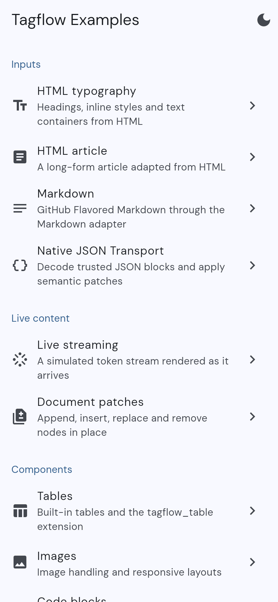
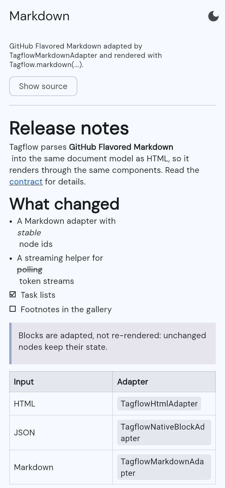
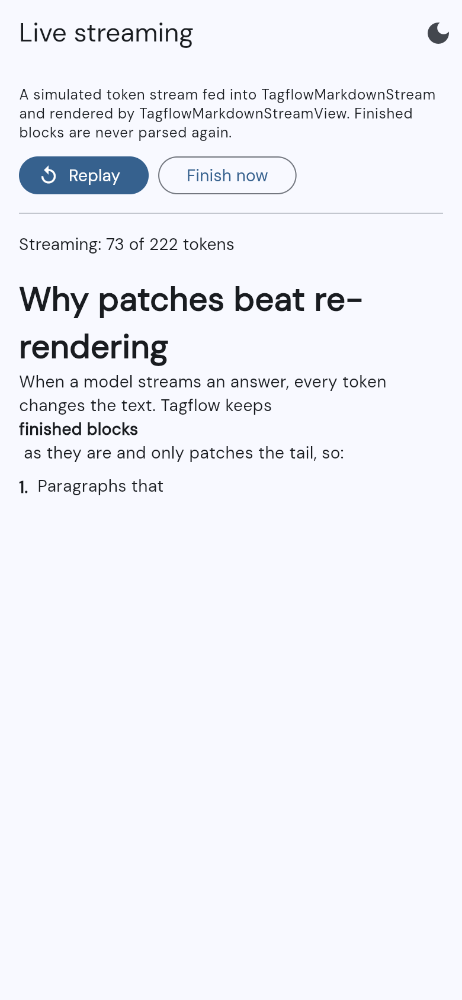
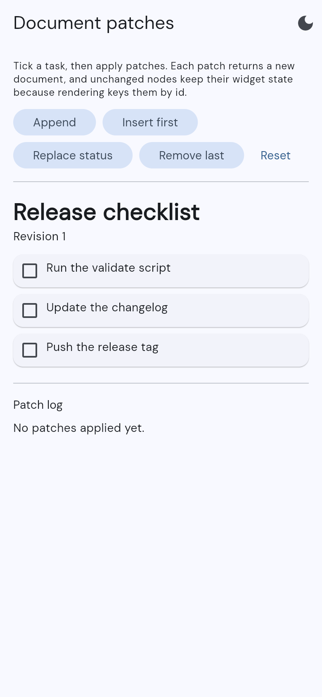
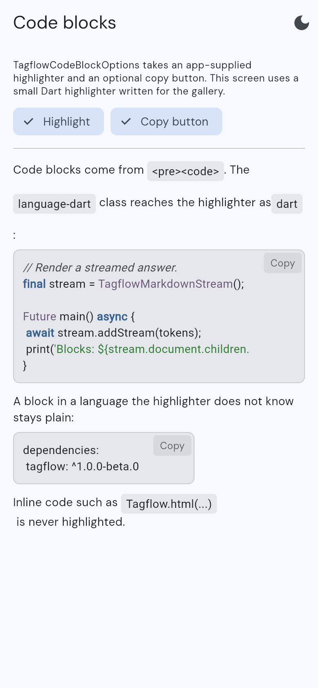

# Tagflow gallery

The example app for [Tagflow](../../README.md). Each screen shows one part of
the runtime, and every screen has a light and dark theme toggle in its app bar.

<p>
  
  
  
  
  
</p>

| Section | Screen | What it shows |
| --- | --- | --- |
| Inputs | HTML typography, HTML article | `Tagflow.html(...)` through `TagflowHtmlAdapter` |
| Inputs | Markdown | GitHub Flavored Markdown through `Tagflow.markdown(...)` |
| Inputs | Native JSON Transport | `TagflowNativeBlockCodec` documents and patch envelopes |
| Live content | Live streaming | A simulated token stream in `TagflowMarkdownStream` and `TagflowMarkdownStreamView`, with no network |
| Live content | Document patches | `appendRootChildren`, `insertBefore`, `replaceNode` and `removeNode`, with widget state kept across patches |
| Components | Tables, Images | Built-in components and the `tagflow_table` extension |
| Components | Code blocks | A Dart highlighter plugged into `TagflowCodeBlockOptions`, and the copy button |
| Safety | Content policy | Blocked tags and URLs, dropped or kept as placeholders |
| Validation | Reference App Route, Internal App Validation | Fixtures for app-authored content |

## Run it

From the repository root, after `dart pub get` and
`dart run melos bootstrap`:

```bash
cd examples/tagflow
flutter run
```

## Tests

`test/gallery_smoke_test.dart` opens every route and fails on any render
error, so a new screen gets a smoke test as soon as it is added to
`allExamples` in `lib/utils/examples.dart`. Behavior tests for the newer
screens are in `test/gallery_routes_test.dart` and
`test/code_example_test.dart`.

```bash
flutter test
```
